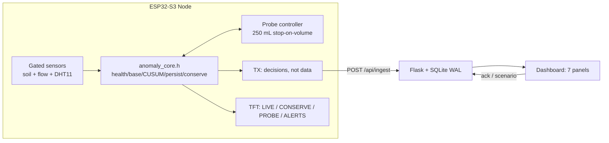
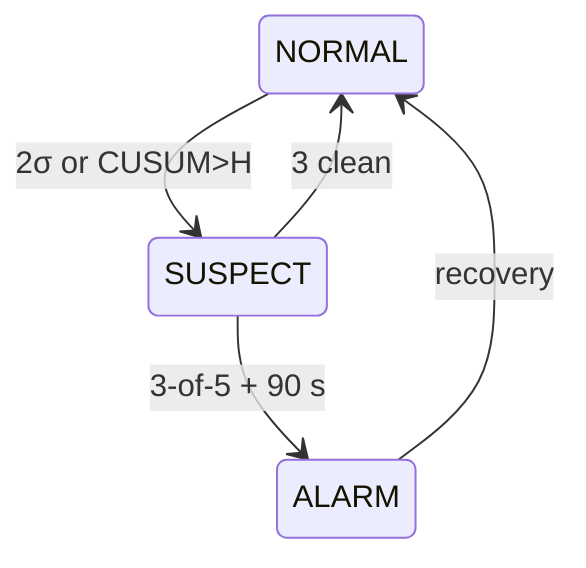
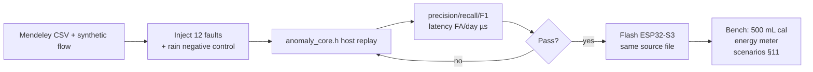
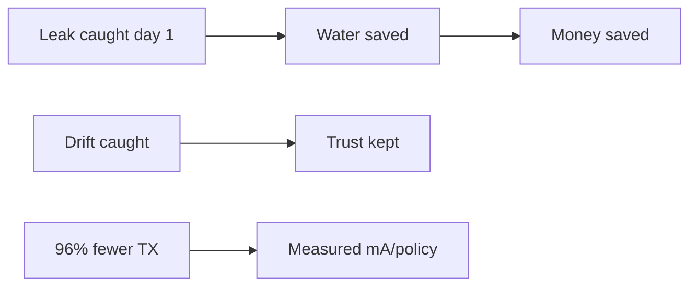

# AgriGuard Edge — Hackathon PPT Content (`docs/ppt.md`)

Copy-paste source for the slide deck. Each slide = **title → bullets (put on slide, ≤6) →
visual → what to say (30–60 s)**. Mermaid blocks are ready to paste into
[Mermaid Live](https://mermaid.live) → export PNG → drop into slides.

Measured numbers below are real (`README.md`, `datasets/README.md`,
`docs/ERRATA.md`): **12/12 injections, 0 FA/day synthetic, ~5 µs/eval,
K=1.0/H=10 via sweep, 31/31 unit tests, pio SUCCESS (RAM 44.4 % / Flash
31.5 %), ~96 % fewer messages, mains-powered demo (12 V + USB).**

> Note: the brief pasted feasibility text under IMPACT AND BENEFITS too —
> treated as a copy-paste slip; impact slide below covers actual benefits.

---

## Slide 1 — Title

**AgriGuard Edge — Edge-Native Irrigation Anomaly Detection on ESP32-S3**
Sub: *Decisions, not data. Flow is the gravitational truth.*
Team, event, date. One-line hook: "A ₹-cheap node that interrogates its own
irrigation and proves every verdict with physics."

**Visual:** hero photo — bench rig (ESP32-S3 + resistive probe in a pot + ZJ-S201
in hose + ST7735 lit). Overlay 3 badges: `12/12 detected` · `0 FA/day` ·
`~96 % fewer messages`.
**Say (20 s):** "Every reading to the cloud dies in a day on a small cell. Ours
is mains-powered and battery-ready — because it sends verdicts, not readings, and shows its working."

---

## Slide 2 — Problem (sets up everything)

- Battery soil nodes must catch leaks / blockages / drift / stress **locally** —
  WiFi TX current is ~100× sleep current; naive node survives **~0.7 days** on a cell.
- Silent leak + drifting probe are **invisible to moisture alone**.
- Dataset reality: no flow channel, no labels, no irrigation flag (arch §1.4).

**Visual:** none (or 2-bar chart: naive 3749 mAh/day vs AgriGuard ≈245, battery-variant reference).
**Say:** "Two faults that cost farmers the most money cannot be seen by the
sensor everyone deploys. That's the gap we built for."

---

## Slide 3 — TECHNICAL APPROACH (a) Stack

Title on slide: **Technical Approach — Technologies Used**

| Layer | Choice | Why (one phrase each) |
|---|---|---|
| MCU | ESP32-S3 DevKitC-1 N16R8 | PCNT pulse counter, ADC1, PSRAM ring buffer |
| Flow | ZJ-S201, 450 p/L nominal (bench-calibrated), via 74AHCT125 / divider → GPIO6/PCNT0 | Ground-truth volume; 5 V → level shift saves the pin |
| Soil / air | Resistive probe (GPIO1, GPIO7-gated vs corrosion) + DHT11 (GPIO4, corroboration only) | Gated 200 ms/sample — saves power AND electrodes |
| Display | ST7735 128×160, TFT_eSPI + LVGL 9, backlight PWM on GPIO9 | Conservation arithmetic live, no cloud needed |
| Firmware | PlatformIO/Arduino sched + **pure-C++ `anomaly_core.h`** (no Arduino in core) | Same file compiles for ESP32 **and** host replay |
| Backend | Flask + SQLite (WAL) + 7-panel dashboard | One file, judge-inspectable, idempotent ingest |
| Data | Mendeley `65jxyrxv7b` slice + synthetic diurnal + injection protocol | Real shape + reproducible faults |

**Visual:** bench wiring photo + `pinout.md` table excerpt.
**Say:** "One detector core, two runtimes — the C++ on the board is
byte-identical to the C++ we validate on a laptop."

---

## Slide 4 — TECHNICAL APPROACH (b) System architecture

Bullets (max 4):
- Gated sensing → `anomaly_core.h` ①–⑥ → controlled-volume probe → TX scheduler.
- Flask ingests idempotent JSON (`msg_id`), stores evidence, serves dashboard.
- TFT shows the same arithmetic standalone — demo survives dead WiFi.

**Visual — Mermaid A (paste → PNG):**



**Photo:** system block from arch §4 as backup; live dashboard screenshot.
**Say:** "Sense, decide, interrogate, then transmit. The screen and the server
show the same verdict from the same core."

---

## Slide 5 — TECHNICAL APPROACH (c) Detector pipeline + conservation gate

Bullets:
- ① Health gate (rail/stuck/spike/flow checks) → ② diurnal baseline (24
  hour-buckets, guarded adaptation) → ③ EWMA-CUSUM → ④ N-of-M persistence →
  ⑤ probe → ⑥ **conservation verdict**.
- Core identity: `V_delivered = ΔV_soil + V_ET + V_leak` — residual is the leak.
- `R > 1.15` is physically impossible ⇒ **probe drift caught with zero labels.**

**Visual — Mermaid B (detector pipeline):**

```mermaid
flowchart TD
    A[① Health gate\nrail/stuck/spike/flow] --> B[② Diurnal baseline\n24 buckets + guarded adapt]
    B --> C[③ EWMA-CUSUM\nK=1.0 H=10]
    C --> D[④ Persistence\nSUSPECT→ALARM, hysteresis]
    D --> E[⑤ Probe 250 mL\nstop-on-volume]
    E --> F[⑥ Conservation gate\nR=(Vsoil+V_ET)/Vdel]
    F --> G[Verdict: OK / LEAK / BLOCKAGE / DRIFT / STRESS]
```

**Visual — Mermaid C (state machine, small, corner of same slide):**



**Photo:** TFT CONSERVATION screen (stacked bar V_del / V_soil / V_ET /
V_resid, red residual) — "the money screen".
**Say (60 s):** "Water delivered but not retained is a leak. More water in the
soil than we ever delivered is impossible — so the probe is lying. No dataset,
no labels, just physics."

---

## Slide 6 — TECHNICAL APPROACH (d) Methodology / process

Bullets: bring-up order that actually happened —
1. Level-shift + 500 mL calibration first (saves the GPIO).
2. Core unit tests (31/31) → replay sweep (K/H fit) → firmware `pio run`.
3. Conservation gate → probe controller → dashboard panels → scenario launcher.
4. Kill checks H+4/H+8/H+12 with documented fallbacks (arch §12).

**Visual — Mermaid D (validation loop):**



**Photo:** calibration shot (outlet into 500 mL bottle) + `make sweep` output.
**Say:** "Every algorithm change validates in seconds on a laptop, not by
reflashing. Judges can re-run it with one command."

---

## Slide 7 — Working prototype (photos you must take)

No bullets — 4 photos + captions:
1. **Rig top-down** with labeled callouts (probe / meter / pump / relay / TFT).
2. **Level shifter close-up** (AHCT125 or divider) + meter reading ≤3.4 V.
3. **TFT 4 screens** (LIVE / CONSERVATION / PROBE / ALERTS).
4. **Dashboard** (all 7 panels, one alert expanded to evidence JSON).

**Say:** "If the venue WiFi dies, the TFT still proves the verdict. If the
rig dies, the replay still proves the algorithm. Two independent demos."

---

## Slide 8 — FEASIBILITY AND VIABILITY (a) Evidence it's feasible

| Claim | Evidence (measured, not asserted) |
|---|---|
| Detector works | 12/12 injections, stress latency ~2 evals, rain silent |
| Thresholds chosen | Sweep: defaults 411 FA/day → K=1.0/H=10 gives 0 FA/day |
| Runs on MCU | ~5 µs/eval, 288 B baseline, RAM 44 % / Flash 31.5 % |
| Flow trustworthy | 500 mL bench calibration, ±2 % re-run target (§5.7) |
| Bandwidth | ~110 msgs/day vs 2880 baseline ≈ **96 % reduction** |
| Energy | Mains-powered demo; measured supply current per policy + 96 % fewer messages (§7 table = battery reference) |

**Visual:** metrics table screenshot from replay `out/` + power bar chart.
**Say:** "A defended 96 % beats an asserted 99 % — we report what we measured."

---

## Slide 9 — FEASIBILITY AND VIABILITY (b) Risks → mitigations

| Risk | Impact | Mitigation (built, not promised) |
|---|---|---|
| 5 V flow kills GPIO | HIGH | Level-shift **before** first power-up; meter check |
| Backlight eats battery (1699 mAh/day tied to 3V3) | HIGH | PWM on GPIO9: off/15 %/100 % → 19 mAh/day |
| 12 V pump needs a real adapter | HIGH | Adapter ≥ stall current, relay on 12 V+, common GND; node on USB/buck |
| Sub-1 L/min leaks invisible | MED | Demo leaks ≥1 L/min; stated as hardware limit §14 |
| Dataset: 101 rows, no diurnal, no flow/labels | MED | Synthetic 72 h tuning source; conservation gives free labels |
| Venue WiFi fails | MED | TFT standalone + replay fallback |

**Visual:** risk matrix (2×2) or the table itself.
**Say:** "Every risk has a fallback we already built — the Could column is what
we sacrifice, never the Must column."

---

## Slide 10 — IMPACT AND BENEFITS

- **Water:** continuous-leak rule catches 24/7 losses moisture can never see;
  every probe cycle is a water audit (retained vs lost, on screen).
- **Money/energy:** node electronics ≈42 mAh/day in the battery variant (84× cut); pump dominates
  — duty cycle, not compute, is the lever (§7 battery reference), stated honestly.
- **Labor:** no labels, no cloud round-trips, self-calibrating ratio (one
  reference cycle) — deployable by a farmer, not an ML engineer.
- **Trust:** every alert carries evidence JSON; undiagnosable alerts are a
  documented failure mode we refuse to ship.
- **Scale path:** one meter = one zone today; second meter → zone localisation.

**Visual — Mermaid E (impact flow, small):**



**Say (45 s):** "The highest-value line of code is one threshold: pump off,
flow non-zero, somebody's valve is weeping money into the soil right now."

---

## Slide 11 — RESEARCH AND REFERENCES

- Dataset (cite on slide + in paper): La Trobe Univ., *Smart Agriculture and
  Plant Health Monitoring using IoT*, Mendeley Data `65jxyrxv7b` (2024),
  CC BY 4.0 — <https://data.mendeley.com/datasets/65jxyrxv7b> (+ catalog
  <https://iotdataset.com/data/smart-agriculture-plant-health-iot-sensors>).
- Methods: EWMA-CUSUM shift detection; MAD robust statistics (σ≈1.4826·MAD);
  hour-of-day conditioned baselines; PCNT hardware pulse counting (Espressif
  docs); LVGL 9 + TFT_eSPI (DeskBuddy stack, adapted §6.6).
- Hardware: ZJ-S201 (450 p/L nominal, bench-calibrated, 1–30 L/min); 12 V pump;
  resistive probe (corrosion-gated); ESP32-S3
  DevKitC-1 N16R8; ST7735; DHT11 limits (±2 °C, ±20 % RH — corroboration only).
- Repo spec: `docs/architechture.md`; deviations: `docs/ERRATA.md`;
  wiring: `pinout.md`.

**Visual:** QR codes to dataset + repo.
**Say:** "If you use this academically, cite the dataset, not us."

---

## Slide 12 — Demo plan (30 s, then DO it)

1. Login → dashboard (panels fill from the live node).
2. Unplug the soil probe → fault alert lands with evidence JSON → ack it.
3. Hold BOOT 3 s — reference probe; crack a fitting, wait for the audit.

**Visual:** demo flowchart (scenarios §11, defensive order 1→2→6→8→9→3→4→5).
**Backup:** recorded video of every scenario (arch §12: record by H+18).

---

## Appendix slides (keep hidden, open on questions)

- A: Verdict bands table (§5.6, retention ratio R).
- B: Pin map (from `pinout.md`).
- C: Power budget table (§7) + backlight A/B result.
- D: Honest limitations (§14, all 8) — opening this slide voluntarily wins
  more points than any feature slide.
- E: Defense Q&A crib (§13 table — sub-1 L/min, "rules aren't ML", V_wetted,
  99 %→96 %, multi-zone).
